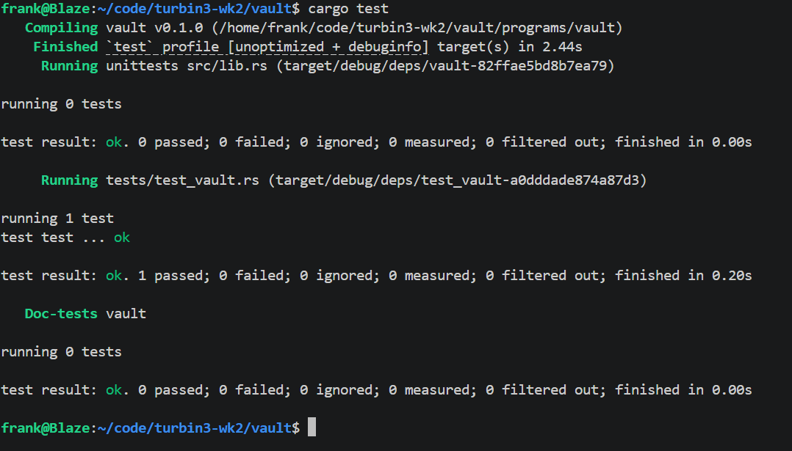

# Solana Vault (Turbin3 Q4 2026, Week 2)

A per-user SOL vault on Solana, built with Anchor 1.x and tested with LiteSVM.
Each user gets their own vault PDA that only they can deposit to, withdraw from, or close.

## Instructions

| Instruction | Signer | What it does |
|---|---|---|
| `initialize` | user | Creates `vault_state` (stores both bumps) and funds the vault with the rent-exempt minimum |
| `deposit(amount)` | user | Transfers SOL from the user to the vault (CPI to the System Program) |
| `withdraw(amount)` | user | Transfers SOL from the vault back to the user; the vault PDA signs via seeds |
| `close` | user | Drains the vault completely and closes `vault_state`, refunding all rent to the user |

## Accounts

| Account | Seeds | Owner | Holds |
|---|---|---|---|
| `vault_state` | `["state", user]` | vault program | `vault_bump`, `state_bump` |
| `vault` | `["vault", user]` | System Program | the user's SOL |

Seeds are defined once in `constants.rs` (`STATE`, `VAULT_SEED`) so every instruction derives the same addresses.

## Design notes

- **PDA signing:** the vault has no private key. `withdraw` and `close` use `CpiContext::new_with_signer` with the vault's seeds and stored bump, so only this program can move funds out.
- **Rent:** `initialize` funds the vault with the rent-exempt minimum. `withdraw` never touches that reserve (`saturating_sub`), so the vault stays alive until `close`.
- **Close:** transfers the vault's full balance, then Anchor's `close = user` constraint deletes `vault_state` and returns its rent.

## Errors

| Code | Name | When |
|---|---|---|
| 6000 | `InvalidAmount` | deposit or withdraw of 0 |
| 6001 | `InsufficientFunds` | withdraw exceeds the balance above the rent reserve |

## Tests

LiteSVM test in `programs/vault/tests/test_vault.rs` runs the full lifecycle:

1. `initialize`: `vault_state` exists and the vault holds exactly the rent minimum
2. `deposit` 0.5 SOL: vault balance increases by 0.5 SOL
3. `withdraw` 0.1 SOL: vault balance decreases by 0.1 SOL
4. `close`: `vault_state` no longer exists and the vault balance is 0



## Run it

```bash
anchor build
cargo test
```

## What I learned

- How a PDA can hold funds that only a program can move, and how the program "signs" for it with seeds and a bump
- The difference between `CpiContext::new` (the user signs) and `new_with_signer` (the program signs for a PDA)
- How Anchor account constraints (`seeds`, `bump`, `init`, `close`) enforce security before any handler code runs

## Credits

Built during the Turbin3 Q4 2026 Builders Cohort. `initialize`, `deposit` and the test harness follow the class code; `withdraw` and `close` are my own implementation.